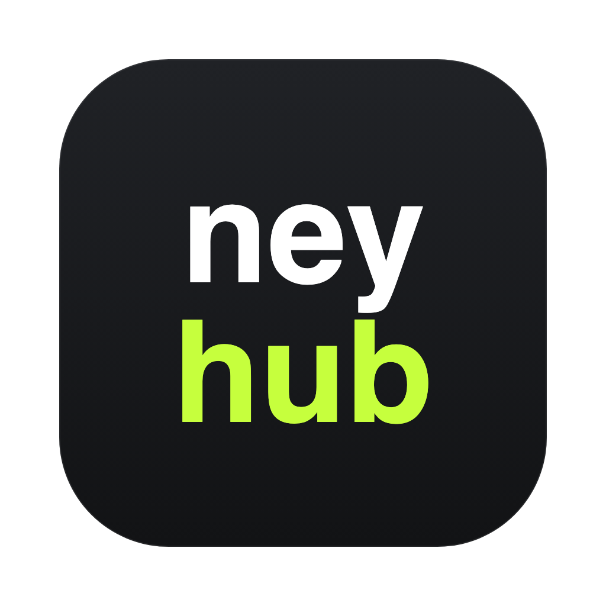
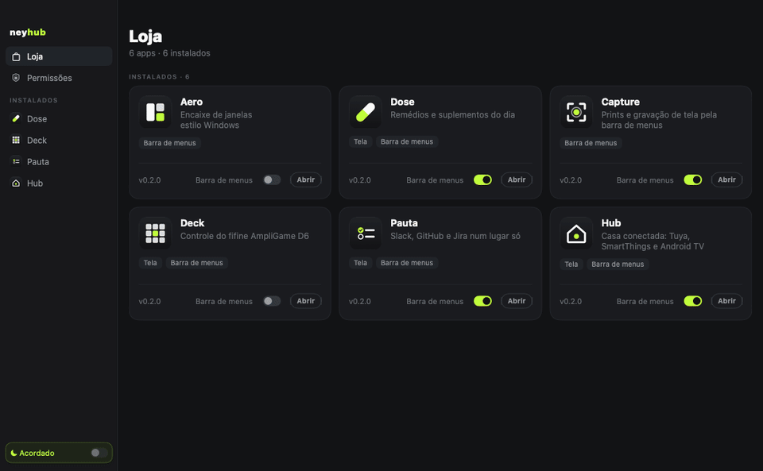

<p align="center"></p>

# NeyHub

Loja e hub dos meus apps de barra de menus do macOS: instala, atualiza e usa cada app num lugar só, com as permissões dadas uma vez e sem lotar a barra de menus.

[Baixar a última versão](https://github.com/yagoramires/neyhub/releases/latest) · [Reportar problema](https://github.com/yagoramires/neyhub/issues/new)



Cada app continua sendo um repositório separado e funciona sozinho, fora do NeyHub. Na 0.1.0 a Loja tem seis:

| App | O que faz |
|---|---|
| [Aero](https://github.com/yagoramires/aero) | Encaixe de janelas como no Windows (só barra de menus). |
| [Dose](https://github.com/yagoramires/dose) | Remédios e suplementos do dia (barra de menus e tela). |
| [Capture](https://github.com/yagoramires/capture) | Prints e gravação de tela pela barra de menus (só barra de menus). |
| [Deck](https://github.com/yagoramires/deck) | Configura o fifine AmpliGame D6 (barra de menus e tela). |
| [Pauta](https://github.com/yagoramires/pauta) | Slack, GitHub e Jira num lugar só (barra de menus e tela). |
| [Hub](https://github.com/yagoramires/hub) | Casa conectada: Tuya, SmartThings e Android TV (barra de menus e tela). Exige macOS 15. |

Um app que ainda não tem release aparece na Loja como **Em breve**, sem o botão **Instalar**.

## Instalar

1. Baixe o `NeyHub-x.y.z.dmg` na [página de releases](https://github.com/yagoramires/neyhub/releases/latest) e arraste o **NeyHub.app** para **Aplicativos**.
2. Abra o NeyHub. Ele é assinado com um certificado próprio, não com um certificado pago da Apple, então na primeira vez o macOS avisa que não conseguiu verificar o desenvolvedor. Vá em **Ajustes do Sistema → Privacidade e Segurança**, role até o fim e clique em **Abrir Mesmo Assim**. No macOS 14 também dá para clicar com o botão direito no app → **Abrir** (a partir do macOS 15 esse atalho não libera mais o app). Só na primeira vez.
3. Na **Loja**, clique em **Instalar** no card do app. O NeyHub baixa o pacote do GitHub, confere a assinatura e o app já começa a rodar.

O NeyHub entra nos itens de login na primeira vez que abre e continua rodando quando você fecha a janela (os apps dele, como o Aero, precisam ficar ativos). Com a janela fechada ele sai do Dock e fica só na barra de menus; para deixar o ícone sempre no Dock, ligue **Mostrar ícone no Dock** no menu do ícone da barra de menus. Para sair de verdade: **NeyHub → Sair do NeyHub** (`⌘Q`). Abrir o NeyHub de novo com ele já aberto só traz a janela de volta.

Se o app avulso estiver aberto, o NeyHub pergunta antes de iniciar o plugin: **Fechar** encerra o avulso e segue pelo NeyHub; **Agora não** deixa o app pausado no card. Pausado ao abrir o NeyHub, ele começa sozinho assim que o avulso fechar. Pausado com o app em uso, ele só volta reiniciando: o card mostra **Pausado — reinicie o NeyHub para voltar** com o botão **Reiniciar NeyHub**.

Para desinstalar um app, abra o card dele na Loja e clique em **Desinstalar**: ele para na hora, os avisos dele saem da Central de Notificações e a pasta some no próximo início. Reinstalar na mesma sessão também fica para o próximo início. Sair ou reiniciar o NeyHub não apaga os avisos.

Requer macOS 14 ou mais novo, Apple Silicon ou Intel. O Hub exige macOS 15: num macOS 14 o card dele mostra **Precisa do macOS 15.0**.

## Permissões

Os apps rodam dentro do NeyHub, então o macOS pede as permissões para o NeyHub, não para cada app. A tela **Permissões** lista o que os apps instalados precisam, quem usa cada uma e se já está concedida; **Conceder** abre o painel exato dos Ajustes do Sistema. Conceda uma vez: a permissão continua valendo depois das atualizações, porque o NeyHub é sempre assinado com o mesmo certificado.

A tela lista só as permissões que algum app instalado usa:

- **Acessibilidade**: para o Aero mover e redimensionar janelas e para as teclas de atalho e de mídia do Deck.
- **Notificações**: para os lembretes do Dose e os avisos do Pauta. Os avisos de todos os apps passam pelo NeyHub, e o toque leva ao app (mesmo quando o toque é que abre o NeyHub).
- **Gravação de Tela**: para o Capture.
- **Microfone**: só para o Capture com **Gravar o microfone** ligado. Aparece como **opcional** e não acende o ponto da barra lateral; o próprio Capture avisa quando falta.
- **Rede local**: para o Hub achar e controlar a Android TV. Não aparece na tela: o macOS pergunta sozinho na primeira vez que o Hub procura a TV.

Nenhum app pede permissão no meio do uso: quando falta, ele mostra o aviso e leva para essa tela. Um ponto ao lado de **Permissões** na barra lateral avisa que falta alguma.

O app avulso (fora do NeyHub) continua com as permissões dele, à parte.

## Retorno de login

O login do SmartThings no Hub volta para o Mac por um link `hubmac://`, e quem atende é o NeyHub: ele entrega ao Hub que roda dentro dele. Se o Hub avulso estiver aberto (o plugin fica pausado), o NeyHub repassa o link para ele. Se nenhum app esperava o login, aparece **Nenhum app esperava este login**; é só abrir o app que pediu e tentar de novo. Um link que chega enquanto o NeyHub ainda está abrindo espera os apps iniciarem.

## Como usar

- **Loja**: o catálogo de apps. Cada card mostra a versão instalada ou disponível e a ação **Instalar**, **Atualizar** ou **Abrir**. Clicar no card abre o detalhe: modo de exibição, configurações do app, novidades de cada versão e **Desinstalar**.
- **Instalados** (barra lateral): os apps com tela. Clicar abre a tela do app dentro da janela do NeyHub, com o modo de exibição no topo.
- A janela abre com 1100 × 680 na primeira vez (a Casa do Hub cabe em 3 colunas) e depois lembra o tamanho e a posição.
- **Acordado** (rodapé da barra lateral): não deixa o Mac dormir, nem com a tampa fechada. Fica verde quando ligado.
  - Na primeira vez que você liga, o macOS pede sua senha de administrador **uma vez**. O NeyHub instala uma regra em `/etc/sudoers.d/neyhub` que libera só dois comandos, `pmset -a disablesleep 1` e `pmset -a disablesleep 0`, sem senha, só para o seu usuário. Depois disso ligar e desligar não pede mais nada.
  - Só desliga quando você manda. Fechar a janela ou sair do NeyHub não desliga.
  - O switch mostra sempre o estado real do sistema (`pmset -g`), não um valor guardado.
  - Clique com o botão direito no switch para **Mostrar Acordado na barra de menus**.
  - Conflito conhecido: outro app que também mexe no `pmset disablesleep` pode religar o sono por conta própria e desfazer o Acordado sem aviso. Como o switch lê o estado do sistema, ele mostra a mudança. É só ligar de novo.

## Atalhos

| Atalho | O que faz |
|---|---|
| `⌘Q` | Sai do NeyHub (o Acordado continua como está). |
| `⌘W` | Fecha a janela; os apps continuam rodando. |
| `⌘M` | Minimiza a janela. |
| `⌘Z` / `⇧⌘Z`, `⌘X`, `⌘C`, `⌘V`, `⌘A` | Edição de texto nos campos dos apps. |

Os atalhos de cada app estão no README dele.

## Modos de exibição

O visual é o tema Grafite: escuro, denso, com um acento verde-limão. Os apps usam o mesmo tema, dentro e fora do NeyHub.

Cada app escolhe onde aparece, no detalhe do card na Loja (ou no topo da tela do app):

- **Tela**: o app entra em **Instalados** e abre dentro da janela do NeyHub.
- **Barra de menus**: o NeyHub mostra o ícone do app na barra de menus.
- **Os dois**.

O próprio NeyHub tem ícone no Dock e na barra de menus (ícone `square.grid.2x2`), os dois ligados por padrão; para ocultar cada um use o menu do ícone ou o menu **NeyHub**. Sempre sobra um dos dois (apagar o último religa o outro).

App sem tela (como o Aero e o Capture) só tem **Mostrar na barra de menus**. Esconder o ícone nunca desliga o app: o Aero continua encaixando e o Dose continua lembrando.

## Atualizações

O NeyHub confere o GitHub 5 s depois de abrir e a cada 6 h: a versão nova dele e a de cada app instalado. Tudo é baixado em segundo plano, conferido (assinatura, contrato, id e versão) e guardado; nada é trocado com o app em uso. Quando há algo pronto, a Loja mostra "Atualizações prontas" com o botão **Reiniciar agora**. Se você não clicar, a atualização entra no próximo início (o NeyHub nunca reinicia sozinho). Um app com contrato diferente do NeyHub instalado é recusado e a versão atual continua intacta. Depois de atualizar, uma janela mostra as novidades do NeyHub e de cada app que mudou.

## Build local

Precisa só das Command Line Tools (`xcode-select --install`), sem Xcode.

```sh
scripts/setup-signing.sh   # uma vez: cria o certificado "Aero Local Signing" no Chaveiro
scripts/build.sh --run     # compila, assina e abre build/NeyHub.app
scripts/selftest.sh        # testes (imprime "selftest ok")
scripts/icon.sh            # ícones do NeyHub e dos apps (Resources/icon-src → .icns)
```

O `docs/tour.gif` sai do modo `NeyHub --tour <quadros> <telas>`: a janela de verdade com os seis apps instalados, e em `<telas>/<app>.png` a tela de cada app desenhada pelo próprio app com dados de exemplo (`Dose --snapshots`, `Deck --snapshots`, `Pauta --snapshots`, `Hub --render screen@898`). Nenhum dado real entra no GIF.

Sem o certificado o build falha de propósito: plugins e atualizações só são aceitos com essa assinatura.

Os apps dependem do produto `NeyKit` deste pacote (contrato de plugin, tema Grafite e tipos comuns); as cascas avulsas usam também o `NeyKitApp` (atualização, novidades e a checagem do NeyHub). Um app que também é plugin chama `HubCheck.leaveForHub` ao abrir e só então declara `NeyHubAware = true` no Info.plist; com essa chave o NeyHub não mostra o alerta dele quando o avulso abre. O `templates/release-app.sh` é o script de release que cada app copia.

## Patch notes

Veja o [CHANGELOG](CHANGELOG.md).

## Licença

[MIT](LICENSE)
